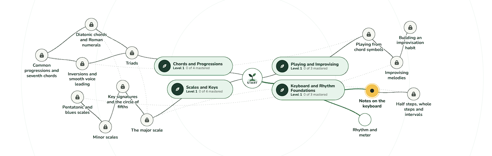

<p align="center">
  
</p>

<p align="center">
  <a href="https://github.com/giuvul/yuo/releases/latest"></a>
  <a href="LICENSE"></a>
  <a href="https://github.com/giuvul/yuo/actions/workflows/ci.yml"></a>
  <a href="https://github.com/giuvul/yuo/stargazers"></a>
</p>

<p align="center">
  <b>Learn anything. Grow your skills.</b><br>
  A self-hosted app that turns what you want to learn into your own learning path:<br>
  a skill tree of short lessons with narrated videos, readings, practice, tests, reviews and a tutor.
</p>

<p align="center">
  <a href="#get-started-with-an-ai-assistant">Get started</a> ·
  <a href="#what-you-get">Features</a> ·
  <a href="#your-data-stays-with-you">Privacy</a> ·
  <a href="docs/architecture.md">Architecture</a> ·
  <a href="CONTRIBUTING.md">Contributing</a>
</p>

> [!TIP]
> If Yuo helps you learn something, **[give it a star on GitHub](https://github.com/giuvul/yuo)**. It helps other
> people find it, and it tells me the project is worth the time.

## A look inside

<p align="center">
  
</p>
<p align="center"><sub>A path is a skill tree you can explore: branches around the start, skills that unlock as you master
them, and the route to where you are now.</sub></p>

<p align="center">
  
</p>
<p align="center"><sub>Every lesson can come as a narrated video made for it, with captions and the reading underneath.</sub></p>

## What you get

- **A path that starts where you are.** Say what you want to learn and why; Yuo checks your level with a few
  questions, then plans a skill tree you can explore as a graph or a list.
- **Lessons written for you.** Readings with cited sources, checked by a second model before you see them, and
  narrated videos made for each lesson, reviewed and repaired before they are published.
- **Practice that sticks.** Seven exercise types, skill tests that unlock what comes next, extra lessons when a
  test shows a gap, and spaced review with flashcards so you keep what you learned.
- **A tutor beside every screen.** It knows what you are looking at, guides instead of giving away test
  answers, and remembers only what you let it.
- **Your AI, your choice.** Your Claude or ChatGPT subscription, an OpenRouter key, a key from Anthropic,
  OpenAI, Google, Mistral, DeepSeek, xAI or Qwen, or a model on your own machine. Every choice shows what a
  typical path costs, or how much of your plan it uses.
- **On every device.** Run it on a server and learn from your phone, tablet and laptop, with passkeys, an
  installable app and an offline mode that syncs when you are back.
- **Share what you made.** Export a path for someone else to study, or as CSV, Anki, Moodle XML, web pages,
  videos with subtitles, BibTeX or CSL JSON.
- In English, Italian, Spanish, Portuguese and German, with light and dark themes.

## Get started with an AI assistant

Paste this into an AI coding assistant (Claude Code, Codex, Cursor or similar) on the computer or server where
Yuo should run:

```text
Install Yuo for me, a self-hosted app that builds personal learning paths. Read
https://raw.githubusercontent.com/giuvul/yuo/main/SETUP.md in full before you do anything, and follow it.
Check this machine first without changing anything. Then tell me what you found, ask me the questions it
lists that you could not answer, and propose a plan. You may suggest answers about me from what you
already know about me; ask me before using them. Wait for my OK before you install anything, use sudo or
administrator rights, or open ports. Never ask me to type API keys or passwords into this chat: I will enter
them in Yuo itself.
```

It looks at the machine, asks what it could not find out, installs Docker if it is missing and then Yuo. It
recommends the server version (Docker), which is the full Yuo with narrated videos; the desktop app, which
needs no Docker, is text only: no videos. It also asks what you want to learn first and drafts your first
path from your answer, so Yuo's setup starts from that draft instead of an empty form.
[SETUP.md](SETUP.md) is what it follows; you can read it or follow it yourself.

## Your data stays with you

Yuo has no account with us, no cloud service, no telemetry and no analytics. Everything you put into it (your
profile, your goals, your answers, notes, tutor conversations and progress) is stored only on the computer or
server where you run Yuo. Nothing is sent to the people who make Yuo, or to anyone else.

The only way your learning data leaves that machine is the AI model you choose, because it has to read it to
write lessons and answer you. The model provider you pick (Claude or ChatGPT through your own subscription,
OpenRouter, an AI company's API) receives what each request needs, under that provider's own terms. With a
model on your own machine, nothing leaves at all. Video narration is made by a voice that runs on your
machine too.

Yuo also downloads a few things that carry none of your data: its own updates (a daily check of the release
file, which you can turn off in Settings), public model prices from OpenRouter, and the programs and voice
model it needs. On a server, the HTTPS certificate or Tailscale you set up connects your devices to it, not
to anyone else. Sharing a path or exporting it happens only when you do it.

## Install by hand

| | Server version (Docker) | Desktop app |
|---|---|---|
| Best for | most people: your own computer or a server | a quick try without Docker |
| Narrated videos | yes | no, text only |
| Learn from other devices | yes (Tailscale, your own domain, or a proxy) | no, this computer only |
| Runs on | anywhere Docker runs | Windows 10 and 11, macOS (Apple silicon), Linux |
| Guide | [packaging/container](packaging/container/README.md) | [packaging/desktop](packaging/desktop/README.md) |

[SETUP.md](SETUP.md) has every step, for people as well as AI assistants.

## For developers

```sh
uv run scripts/dev.py      # installs the locked dependencies, runs the API and the web app
uv run scripts/ci.py       # every check CI runs
```

You need [uv](https://docs.astral.sh/uv/) and Node.js LTS; uv brings the Python version Yuo needs. How the system
is built: [docs/architecture.md](docs/architecture.md). The path package format:
[docs/spec/path-package.md](docs/spec/path-package.md).

## Contributing

Bug reports, ideas, translations and pull requests are welcome. Start with [CONTRIBUTING.md](CONTRIBUTING.md),
and please follow the [Code of Conduct](CODE_OF_CONDUCT.md). Security issues go through
[SECURITY.md](SECURITY.md), never a public issue.

## Support the project

- ⭐ [Star Yuo on GitHub](https://github.com/giuvul/yuo) so more people find it.
- Share a path you made with Yuo, or tell me what you learned with it.
- Report what did not work: every issue makes the next version better.

## Credits

Yuo is designed and built by **Giuseppe Vulduraro**.

- Website: [giuseppevulduraro.com](https://giuseppevulduraro.com)
- GitHub: [@giuvul](https://github.com/giuvul)

It stands on the shoulders of great open-source work, among others [FastAPI](https://fastapi.tiangolo.com),
[Pydantic](https://docs.pydantic.dev), [SQLite](https://sqlite.org), [React](https://react.dev),
[TanStack](https://tanstack.com), [React Aria](https://react-spectrum.adobe.com/react-aria/),
[React Flow](https://reactflow.dev), [Lingui](https://lingui.dev), [Remotion](https://www.remotion.dev),
[Kokoro](https://huggingface.co/hexgrad/Kokoro-82M), [FFmpeg](https://ffmpeg.org) and
[FSRS](https://github.com/open-spaced-repetition). Every third-party component and its licence is listed in
[THIRD_PARTY_LICENSES](THIRD_PARTY_LICENSES).

## Licence

Yuo is released under the [Apache License 2.0](LICENSE); see also [NOTICE](NOTICE).

Videos are rendered with [Remotion](https://www.remotion.dev), which has its own licence: it is free for
individuals, non-profits and companies of up to three people; larger companies that run Yuo with videos need a
[Remotion company licence](https://www.remotion.dev/license).
