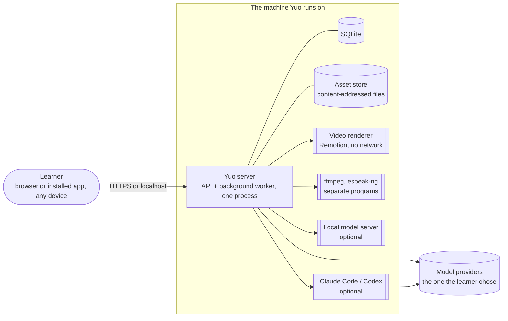

# Architecture

How Yuo is built: the parts, how they talk, where data lives. For installing it, see [SETUP.md](../SETUP.md);
for the path package format, see [spec/path-package.md](spec/path-package.md).

## 1. The system at a glance



- **One process** serves the API and the web app and runs the background worker (uvicorn with exactly one
  worker: one database writer, one event stream).
- **Learning data stays on the host.** The only outbound traffic that carries it goes to the model provider
  the learner chose. With a model on the same machine, nothing leaves.
  One opt-in exception: with lesson videos from YouTube (setting `video.source`), the searches send each
  lesson's topic to YouTube (recorded in `egress_record`), its captions are read, and a video loads from
  YouTube in the learner's browser when they press play.
- **Two ways to run it:**
  - **Server version** (`packaging/container`): a Docker image with a second container that renders videos
    with no network. Optional Caddy for HTTPS, or Tailscale, or the learner's own proxy.
  - **Desktop app** (`packaging/desktop`): launcher scripts install a pinned uv, Python and Yuo, and start it
    on loopback, signed in. No video renderer (text only).

## 2. Code layout

```
yuo/                 Python backend (3.14, uv-managed)
  core/              ids, clock, hashing, money, errors, logs, enums; the LLM and media ports
  db/                SQLite: connections (one writer thread, read pool), row models, schema, migrations,
                     backups, the asset store, erasure
  curriculum/        paths, the skill tree, the level check, "What next?"
  content/           lesson bodies, review verdicts, video scripts and captions
  assessment/        exercise types (one plugin per type), grading, the review question bank
  learning/          the event log and its projections, spaced review (FSRS)
  tutoring/          tutor policies, the guess detector, the leak checker, nudges
  generation/        jobs, the stage runner, structured output, priority lanes, the cost estimate
  sharing/           the path package: records, the deterministic writer, the reader, format upgrades
  setup/             settings registry, model presets and bindings, vendors, the machine probe, consent
  app/               the application service: one facade over feature parts (paths, study, review, tutor,
                     video, sharing, onboarding, auth, erasure, updates, ...)
  api/               FastAPI routers, request and response schemas, the event stream, the web app
  adapters/          everything that talks to the outside world (see section 4)
  data/              shipped data: model capabilities, cost profiles, plan limits, voice data
  cli.py, main.py    the `yuo` command and the server's wiring
web/                 React 19 + TypeScript PWA (TanStack Router and Query, React Aria, CSS Modules, Lingui)
renderer/            Remotion project that turns a model-written scene module into an MP4
packaging/           container/ (Dockerfile, compose, Caddyfile) and desktop/ (launchers, guide)
scripts/             development, checks, code generation, release builds
tests/               unit, integration and fitness tests
docs/                this file, the package spec and its fixtures, logo assets
```

### Boundaries the checks enforce

`uv run scripts/ci.py` runs import-linter and the fitness tests in `tests/fitness`:

- Contexts (`curriculum`, `content`, `assessment`, `learning`, `tutoring`, `generation`, `sharing`, `setup`)
  do not import each other; they depend on `core`.
- `core` depends on nothing else in `yuo`.
- The application service's feature parts do not import each other; they meet through `yuo.app.ports`.
- The API never touches `yuo.db`; it calls the application service.
- Only `yuo.adapters` imports vendor SDKs (`openai`, `anthropic`, `httpx`, `keyring`, `genanki`) or starts
  child processes. GPL tools (ffmpeg, espeak-ng) run only as separate programs, from `yuo.adapters.tools`.
- In-process dependencies carry a permissive or LGPL licence (`scripts/licence_gate.py`).

## 3. Data

### SQLite

- **One writer thread** owns the only read-write connection. Writes are short units of work through a queue
  and never span a network call or a model call. Readers use a small pool of read-only connections.
- All tables are `STRICT`. WAL mode, `foreign_keys`, `secure_delete` and the same pragmas on every connection.
- **The schema is generated** from the row models in `yuo/db/rows.py` (`uv run scripts/gen_schema.py`).
  Changes ship as forward-only numbered migrations in `yuo/db/migrations`, run before the writer starts.
- Identifiers are UUIDv7. Times are UTC instants written by Python. Money is integer micro-units.

### The learning record

What the learner does (answers, reviews, attempts, notes) is an **append-only event log**. Progress,
mastery, review schedules and streaks are **projections** rebuilt deterministically from it. Events can come
from any device: the web app keeps an **outbox** in IndexedDB and syncs it when it is back online, and the
server applies late or out-of-order events by recomputing only what they touch.

### Content and versions

Lessons, items and videos are versioned. A version is published only after it passes the quality gate
(section 5). Media files live in a **content-addressed asset store** on disk (`<hash[:2]>/<hash>`), so the same
file is stored once.

### Privacy in the data

Rows carry a data class. Free text the learner wrote is never written to logs. **Erasure** is the only path that
deletes personal rows, including from the event log: a tutor conversation, the video watch history, or all
personal data of one path. Backups are taken once a day, checked, and the newest seven kept.

## 4. Adapters and ports

The core talks to the outside world only through ports (`yuo/core/llm.py`, `yuo/core/media.py`) and the
adapters in `yuo/adapters`:

| Adapter | What it does |
|---|---|
| `llm/` | OpenAI-compatible endpoints (OpenRouter, local servers such as Ollama), the Anthropic API, vendor keys (Google, Mistral, DeepSeek, xAI, Qwen and others), and the Claude Code and Codex programs for subscriptions |
| `tts/` | Kokoro, a local voice: narration never leaves the machine |
| `renderer/` | Remotion in a network-isolated sandbox: `bwrap` or `unshare` on Linux, or the render container (a spool folder shared with a container that has no network) |
| `tools/` | ffmpeg and espeak-ng, run as separate programs |
| `youtube.py` | Lessons built on a YouTube video: search (the YouTube Data API with the learner's key, else yt-dlp), captions (youtube-transcript-api; `YUO_YOUTUBE_PROXY` routes them through a proxy) a video's sound when YouTube refuses the captions (yt-dlp; Yuo transcribes it on the machine and deletes it) and whether a video is still there (oEmbed). The picture is never downloaded |
| `export/` | standard-format exports: CSV, Anki, Moodle XML, readings, videos with subtitles, BibTeX, CSL JSON |
| `exposure/` | how other devices reach a server: Tailscale Serve, Caddy with a public name, or the learner's own proxy, plus a reachability check |
| `secrets.py` | API keys in the OS keychain on desktops, or an AES-GCM encrypted file keyed from a secret in the container |
| `cli_access.py` | installing and signing in Claude Code or Codex from Yuo's setup |
| `release_feed.py` | the daily update check (a public release file; it can be turned off) |

Which model does which job is a **binding per role** (planner, writer, reviewer, tutor, video author, critics),
chosen from presets in setup. `yuo/data/capabilities.json` records how each model is called (native or prompted
structured output, effort, output caps) and whether it was measured.

## 5. Generation

- **Jobs** live in the database and are worked by background threads. A job cut short by a crash or restart is
  queued again at startup and resumes from its finished stages.
- **The stage runner**: every model call is a stage run, keyed by the hash of all its inputs (prompt version,
  model, inputs). A repeated stage is served from the cache; every call is recorded in a budget ledger, and calls
  to remote models in an egress record.
- **Priority lanes**: tutor turns and anything the learner is waiting for go ahead of background writing.
- **The quality gate**: a lesson is written, checked by deterministic rules, then reviewed by a second model;
  findings go back for one repair round, otherwise the lesson fails. Practice and test items are answered blind
  by another model before they are published, so an item whose key is wrong never reaches the learner.
- **Videos**: the author model writes a narration script and a scene module (TSX) for the lesson; the module is
  compiled and linted; narration is made locally with Kokoro; stills are reviewed by visual, consistency and
  fact critics; up to three repair rounds keep the best one; the final MP4 has captions as a separate WebVTT
  track. Model-written code only ever runs in the renderer's sandbox, never in the server.
- **Estimates**: plan units times token profiles (`yuo/data/cost_profiles.json`) times current prices, as a
  range; for subscriptions, the share of the plan's limits instead (`yuo/data/plan_limits.json`).

## 6. The tutor

Policies are resolved on the server from what the learner is doing (a lesson, practice, a test, a review), never
from what the client claims. Answers are protected in layers, strongest first: before an attempt the model
never sees the answer key; a deterministic detector answers guesses ("is it B?") with a fixed reply, without
calling the model; in checked modes a model leak checker reads every other reply before it is shown and fails
closed; the prompt itself asks for a Socratic style. Replies stream over one
multiplexed Server-Sent Events stream per browser, which also carries job progress and nudges.

## 7. Web app

- React 19 single-page app, built with Vite and served by the Python server; installable as a PWA, with a
  service worker that caches the shell and readings.
- TanStack Router and Query; API types generated from the server's OpenAPI schema (`npm run api:types`), checked
  in CI so client and server cannot drift.
- React Aria Components for accessible widgets; CSS Modules on semantic design tokens, light and dark themes.
- Lingui with message ids for every string, in English, Italian, Spanish, Portuguese and German; a check fails
  the build when an id is missing from a catalog.
- The path graph uses `@xyflow/react` with `d3-force`, loaded only when the graph is shown.

## 8. Security

- **Sign-in** on the server version: passkeys, a password as the fallback, recovery codes, opaque session
  tokens in `__Host-` cookies, a one-time setup code for the first device. One canonical origin per install;
  Host header allowlist and CSRF protection. The desktop app listens on loopback only and signs in from its
  launcher.
- **Untrusted input**: imported packages are read with size limits and never contain executable content;
  model output is validated against schemas; lesson text is stored as a block document, never as markup.
- **Model-written code** (video scenes) runs only in a sandbox with no network access.
- **Secrets** are encrypted at rest, never logged, and never sent to the browser after they are saved.
- **Supply chain**: locked dependencies with hashes, a software bill of materials in `sbom/`, and a licence gate.

Report vulnerabilities as described in [SECURITY.md](../SECURITY.md).
